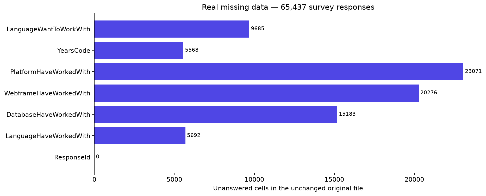

# ConnectAI: AI/ML-Based Social Connection Recommendation Platform

ConnectAI helps people find technology learning partners, connect, build projects, organize community activities and chat. It uses **K-Means** to group similar technology profiles and **Random Forest** to predict languages a person may want to use.

## 1. Which data is used? Understand this first

| Data | Purpose | Part of the 70:30 split? |
|---|---|---|
| Original Stack Overflow Developer Survey 2024 | Teach and evaluate the models using real recorded answers | **Yes** |
| Five presentation accounts: Aarav, Priya, Rohan, Ananya and Kabir | Show profiles, recommendations, connections and chat on the website | **No** |
| Any newly registered website account | Receive recommendations from already saved models | **No** |

**Training is learning from examples. Testing is the final exam. Using the website is applying what the model has learned.** Signing up does not add a person to training data or automatically retrain the models.

The original file has **65,437 responses**. After excluding unanswered target questions and profiles without current technologies, **55,752 responses** are usable.

- **70% training:** 38,993 responses (69.94%).
- **30% testing:** 16,759 responses (30.06%).
- Identical cleaned inputs stay in one group. We split the groups 70:30, so row percentages are very close to that ratio. **No identical-input group crosses the split.**
- To choose model settings, the training portion temporarily contains 31,228 fitting rows and 7,765 validation rows. Validation is a practice check **inside the 70%**.
- After choosing settings, both models and their preprocessing are trained again on **all 38,993 training rows**. Only then do we evaluate the 16,759 test rows.

## 2. Original dataset and profile attributes

Source: [Stack Overflow Developer Survey 2024 — original publisher archive](https://github.com/StackExchange/Survey/tree/main/packages/archive/2024). These are anonymous, real self-reported answers. The original file is preserved and checked against its published file hash. [Source, license and download details](dataset/README.md).

| Website question | Original survey column | Role in ML |
|---|---|---|
| Languages you have used | LanguageHaveWorkedWith | Input |
| Databases you have used | DatabaseHaveWorkedWith | Input |
| Web frameworks you have used | WebframeHaveWorkedWith | Input |
| Platforms you have used | PlatformHaveWorkedWith | Input |
| Years of coding | YearsCode | Input |
| Languages you want to use | LanguageWantToWorkWith | Recorded answer the forest learns to predict |

Names, emails and community interests are website information, not ML input. The desired-language answer is never copied into the model inputs. The model predicts preferences for **16 frequently selected languages**, not friendship success.

## 3. How the two models help

| Model | Simple explanation | Role in ConnectAI |
|---|---|---|
| K-Means — unsupervised learning | Groups similar technology profiles without being given group names | Helps find candidate people with related technologies |
| Random Forest — supervised learning | Many decision trees learn from current technologies and recorded wanted-language answers | Predicts language preferences that contribute to people ranking |

**Example of reciprocal learning:** Aarav has used Python and wants JavaScript. Priya has used JavaScript and wants Python. Their profiles show what each could learn from the other. This is an illustrative website example, not a training label.

The people score combines these observed profile comparisons with a learned preference signal. Explanations show actual shared/complementary technologies. Project suggestions use requirement coverage; activity suggestions use explicit interests. These two features do not claim trained success predictions.

## 4. Cleaning data and handling empty fields

| Situation | What the project does |
|---|---|
| Python, python, repeated values or extra spaces | Normalize names and remove duplicates |
| JS and JavaScript | Treat both as javascript |
| Missing technology answers | Keep them unknown; record that the field is missing |
| Missing coding years | Use the training median, **11 years**, with a missing-value flag |
| Invalid numeric input such as negative years | Reject it in the website API; offline ingestion treats it as missing |
| Missing wanted-language answer | Exclude that survey row from supervised learning; do not invent a label |
| Empty or entirely unsupported website technology profile | Ask for more information instead of producing an ML score |

The original file really contains missing data: **9,685** unanswered wanted-language fields and **5,568** unanswered coding-years fields. Deliberately irregular parser checks are labelled separately from original survey records.

**Read this chart:** a longer bar means more unanswered cells. These are source-data counts, before model training.

[Before/after cleaning snapshot](docs/evidence/survey2024/02-preprocessing-examples.png) · [Executed irregular-input checks](docs/evidence/survey2024/09-irregular-input-checks.png) · [All null/missing-field experiments](docs/RESULTS.md)

## 5. Actual results, explained simply

These results evaluate wanted-language predictions on the **30% test portion**. One decision means one respondent and one language: selected or not selected.

| Measure | Actual result | Easy meaning |
|---|---:|---|
| Accuracy | **84.39%** | Percentage of language decisions that were correct |
| Precision | 66.64% | Of the languages predicted as wanted, how many were actually selected? |
| Recall | 73.04% | Of all genuinely selected languages, how many did the model find? |
| F1 | **0.6969** | Balances precision and recall; closer to 1 is better |
| MSE | 0.1141 | Average squared probability error; lower is better |
| RMSE | 0.3377 | Square root of MSE; lower is better |

**226,278 correct and 41,866 wrong decisions**, out of 268,144. Correct:wrong is approximately **5.40:1**. Getting every evaluated language right for the same person is harder: exact-profile accuracy is 18.32%.

For MSE, a simple example: predicting 0.8 when the actual answer is 1 gives squared error **(0.8 - 1)² = 0.04**. We average errors over all test decisions; RMSE is the square root of that average.

**Read this figure:** green counts correct decisions, red counts mistakes. In the left matrix, the diagonal cells are correct; the other two cells are errors. These are language predictions, not successful or failed friendships.

We also compare against a simple rule: predict that people want to continue their currently used languages. Its F1 is **0.7051** and MSE is **0.1580**, compared with the forest's **0.6969** and **0.1141**. Read F1 together with accuracy and error; an ML model does not automatically beat a simpler method on every measure.

## 6. Settings and learning charts

The highlighted settings were selected using validation **inside the training portion**, not the final test set.

| Selected Random Forest setting | Value | Meaning |
|---|---:|---|
| Number of trees | 160 | How many decision trees contribute |
| Maximum depth | 20 | Maximum levels in each tree |
| Minimum leaf size | 5 | Minimum fitting examples allowed in a leaf |
| Decision threshold | 0.35 | Probability cutoff for predicting a selected language |
| Random seed | 42 | Makes the split and training repeatable |

**Read this table:** green marks the best validation F1 among the tried settings. It does not mean more trees or deeper trees always help.

**Read this chart:** moving right uses more fitting examples. Higher F1 is better. Blue measures fitting rows; green measures separate internal validation rows. A large gap suggests overfitting. These are repeated fits with different data sizes, not neural-network epochs; the outer 30% test data is not used in this chart.

K-Means selected **2 groups** from 2, 3, 4, 5, 6, 8 and 10. Test silhouette is **0.0611**. Silhouette measures group separation: near 1 is more separated, near 0 means overlap. Here the groups overlap, so we do not give them invented expert-category names. [Cluster selection chart](docs/evidence/survey2024/03-cluster-selection.png).

[Full measured results and explained figures](docs/RESULTS.md) · [Detailed methodology](docs/ML_METHODOLOGY.md) · [Simple teacher walkthrough](docs/TEACHER_GUIDE.md) · [Metrics JSON](ml/evaluation/survey2024/metrics.json)

## 7. Technology stack and application flow

| Area | Technology used | What it does in ConnectAI |
|---|---|---|
| Frontend | **React + JavaScript** | Builds interactive pages such as the dashboard, profiles, projects and chat. |
| Page design | **HTML + custom CSS + Inter font** | Controls layout, colors, spacing, typography and responsive behavior on different screen sizes. Styles are defined in frontend/src/style.css. |
| Icons | **Lucide React** | Provides the navigation, action and status icons used throughout the interface. |
| Navigation and API calls | **React Router + Axios** | React Router switches between pages; Axios sends requests to the Django API and receives data. |
| Frontend tools | **Node.js + Vite** | Runs the frontend development server and builds the production website files. |
| Backend | **Python + Django** | Handles application logic, configuration, password hashing and server-side features. |
| REST API | **Django REST Framework (DRF)** | Connects React to the backend through APIs; validates submitted data and checks authentication and permissions. |
| Database | **MongoDB + PyMongo** | MongoDB stores accounts, profiles, projects, connections, events and messages as documents. PyMongo lets the Python backend read and update them. |
| Authentication | **JWT / SimpleJWT** | Uses access and refresh tokens to identify signed-in users when they call protected APIs. |
| Live connection | **WebSockets** | Keeps a connection open so new chat messages and read updates can arrive without refreshing the page. |
| Live chat handling | **Django Channels** | Handles WebSocket connections in Django and groups connected clients by conversation. |
| Temporary messaging and cache | **Redis** | Relays live chat events between Channels connections and provides shared cache storage. MongoDB keeps the permanent message history. |
| Application server | **Uvicorn (ASGI)** | Runs the Django application and supports both normal HTTP requests and WebSocket connections. |
| Containers | **Docker + Docker Compose** | Runs MongoDB and Redis in separate containers with a shared startup configuration, making the development services easier to start consistently. |
| Data preparation | **Pandas + NumPy** | Loads CSV/Excel data, cleans values and prepares numerical arrays for training and evaluation. |
| Machine learning | **Scikit-learn** | Provides K-Means, Random Forest, preprocessing tools and the functions used to calculate model results. |
| Saved models | **Joblib** | Saves and reloads the trained models and preprocessing objects so recommendations can use them without retraining. |

### How Docker makes development easier

**Containerization** means packaging a service with the environment it needs so it can run consistently. **Docker Compose** describes several services in one configuration and starts them together.

In this project:

1. **MongoDB and Redis** run in separate Docker containers defined in [docker-compose.yml](docker-compose.yml). A MongoDB volume preserves database records when the container is restarted.
2. **GitHub Codespaces** uses a development container configured with Python, Node.js and Docker support.
3. **React and Django** run as processes in that development environment. The development script starts the frontend and backend together.

The startup commands in the next section bring up the data services first, then the application: **start-data.sh starts MongoDB/Redis and prepares the database; dev.sh starts Django/React**. All four services then work together.

### How a request moves through the system

~~~mermaid
flowchart LR
    U[User in browser] --> R[React interface]
    R -->|Axios: API requests| D[Django + DRF + Uvicorn]
    D --> M[(MongoDB: saved application records)]
    D --> S[Saved preprocessing + K-Means + Random Forest]
    R <-->|WebSocket connection| C[Django Channels]
    C <--> Q[(Redis: live event relay)]
    C --> M
~~~

**Example:** React sends a profile update to DRF. The backend validates it and stores it in MongoDB. A later recommendation request uses the saved ML models. For chat, MongoDB stores the message and Channels uses Redis to deliver the live update over WebSockets.

Implemented workflows include profiles, explainable people discovery, connection acceptance, project applications/teams, activities by individuals/clubs/NGOs, and private chat with image/file sharing.

[Profile screenshot](docs/screenshots/survey-profile.png) · [Model explanation page](docs/screenshots/survey-method.png) · [Empty-profile behavior](docs/screenshots/survey-empty-profile.png) · [Verified application checks](docs/VERIFICATION.md)

Screenshots use fictional website accounts. Statistical results use the original survey. The functional reference is [connecT University Social Platform](https://github.com/RohitGaira/connecT-University-Social-Platform). Our contribution is source-aligned profiles, reciprocal learning explanations, missing-input handling and reproducible model evidence. [References](docs/REFERENCES.md).

## 8. Run and present

In the existing GitHub Codespace terminal, run:

~~~bash
bash scripts/start-data.sh
bash scripts/dev.sh
~~~

Open forwarded **port 5173**. Saved models are used for recommendations; requests do not train models.

| Presentation profile | Sign-in email |
|---|---|
| Aarav Sharma | aarav@connect.example |
| Priya Verma | priya@connect.example |
| Rohan Mehta | rohan@connect.example |
| Ananya Iyer | ananya@connect.example |
| Kabir Singh | kabir@connect.example |

Passwords are supplied privately. These five accounts are outside training, validation and testing.

To reproduce training in Codespaces after setup, run:

~~~bash
.venv/bin/python -m ml.train --download
.venv/bin/python -m ml.export_data
~~~

The cleaned Excel/CSV includes train/test membership and internal tuning roles.

[Setup](docs/SETUP.md) · [Browse MongoDB visually](docs/DATABASE.md) · [Presentation guide](docs/PRESENTATION.md) · [Tests](docs/TESTING.md) · [Dataset/license](dataset/README.md)

Deployment will happen only when the project owner requests it.
