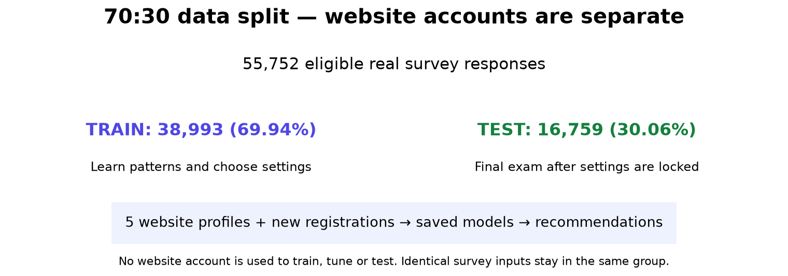
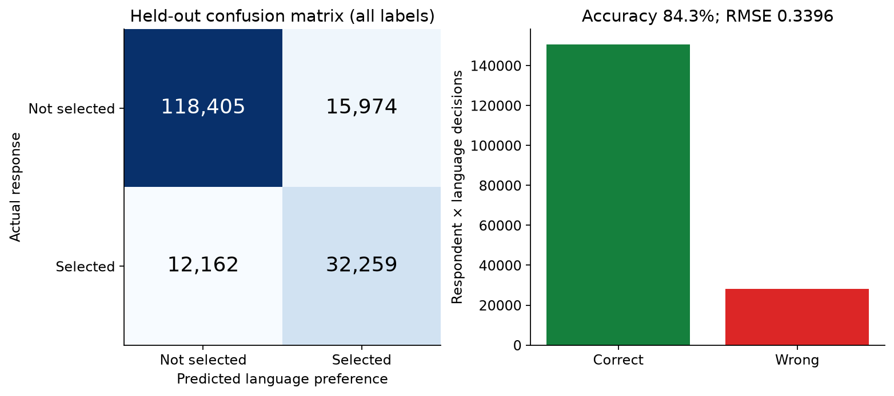
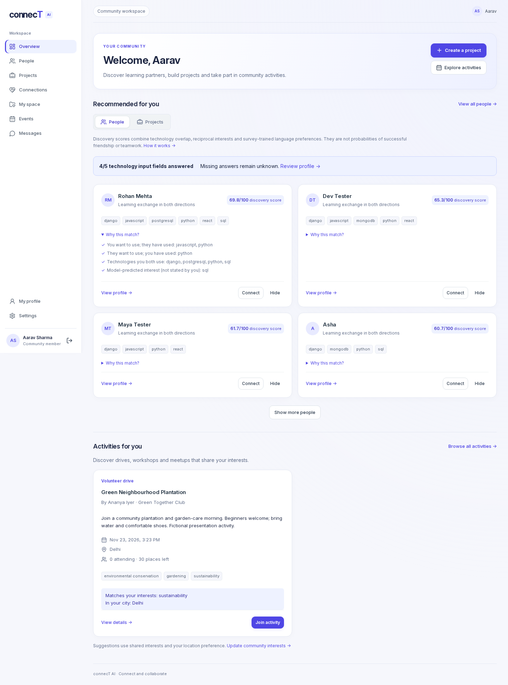

# ConnectAI: AI/ML-Based Social Connection Recommendation Platform

ConnectAI helps people find technology learning partners, connect, build projects, organize community activities and chat. It uses **K-Means** to group similar technology profiles and **Random Forest** to predict languages a person may want to use.

## 1. Which data is used? Understand this first

| Data | Purpose | Part of the 70:30 split? |
|---|---|---|
| Original Stack Overflow Developer Survey 2024 | Teach and evaluate the models using real recorded answers | **Yes** |
| Five presentation accounts: Aarav, Priya, Rohan, Ananya and Kabir | Show profiles, recommendations, connections and chat on the website | **No** |
| Any newly registered website account | Receive recommendations from already saved models | **No** |

**Training is learning from examples. Testing is the final exam. Using the website is applying what the model has learned.** Signing up does not add a person to training data or automatically retrain the models.



The original file has **65,437 responses**. After excluding unanswered target questions and profiles without current technologies, **55,752 responses** are usable.

- **70% training:** 38,993 responses (69.94%).
- **30% testing:** 16,759 responses (30.06%).
- Identical cleaned inputs stay in one group. We split the groups 70:30, so row percentages are very close to that ratio. **No identical-input group crosses the split.**
- To choose model settings, the training portion temporarily contains 31,228 fitting rows and 7,765 validation rows. Validation is a practice check **inside the 70%**.
- After choosing settings, both models and their preprocessing are trained again on **all 38,993 training rows**. Only then do we evaluate the 16,759 test rows.

## 2. Original dataset and profile attributes

Source: [Stack Overflow Developer Survey 2024 — original publisher archive](https://github.com/StackExchange/Survey/tree/main/packages/archive/2024). These are anonymous, real self-reported answers. The original file is preserved and checked against its published file hash. [Source, license and download details](dataset/README.md).

| Website question | Original survey column | Role in ML |
|---|---|---|
| Languages you have used | LanguageHaveWorkedWith | Input |
| Databases you have used | DatabaseHaveWorkedWith | Input |
| Web frameworks you have used | WebframeHaveWorkedWith | Input |
| Platforms you have used | PlatformHaveWorkedWith | Input |
| Years of coding | YearsCode | Input |
| Languages you want to use | LanguageWantToWorkWith | Recorded answer the forest learns to predict |

Names, emails and community interests are website information, not ML input. The desired-language answer is never copied into the model inputs. The model predicts preferences for **16 frequently selected languages**, not friendship success.

## 3. How the two models help

| Model | Simple explanation | Role in ConnectAI |
|---|---|---|
| K-Means — unsupervised learning | Groups similar technology profiles without being given group names | Helps find candidate people with related technologies |
| Random Forest — supervised learning | Many decision trees learn from current technologies and recorded wanted-language answers | Predicts language preferences that contribute to people ranking |

**People recommendations, step by step:**

1. **Find candidates:** K-Means uses current technologies to find profiles in nearby groups. Profiles with shared technologies or a match to your stated interests can also be considered across groups.
2. **Predict preferences:** the saved Random Forest uses your current technologies and coding experience to estimate which languages you may want to use.
3. **Compare profiles:** the system combines shared technologies, matches to your wanted languages and the forest's preference estimates into a discovery score.
4. **Show suggestions:** people are sorted by this score, with explanations based on the actual comparisons.

| Feature | Information used | How it works |
|---|---|---|
| People recommendations | Technologies used, coding experience and your wanted languages | K-Means + Random Forest + profile comparisons |
| Activity suggestions | Community interests, city and location preference | Direct interest matching and sorting; no trained ML model |

**Your suggestions are scored for you.** A candidate's wanted languages do not affect their score or selection in your recommendations. Your own wanted languages are used in profile comparisons; they are not passed to the Random Forest as input. [See the scoring formula](docs/ML_METHODOLOGY.md#live-people-discovery-and-explanations).

**Activities follow a separate path:** compare community interests with activity tags, consider city and location preference, then sort the matching activities. No K-Means or Random Forest model is used for this feature.

Project creation, applications, teams, connections and messaging remain available. Project and teammate suggestions use project requirement coverage. They are separate from the forest's language-preference predictions.

## 4. Cleaning data and handling empty fields

**We preprocess the dataset after downloading it from Stack Overflow.** The publisher supplies an organized CSV, but it still contains unanswered questions and text answers that need preparation for ML. We preserve the original file unchanged and create separate cleaned exports.

### Libraries used for preprocessing

| Library or tool | What it does in this project |
|---|---|
| **Pandas** | Reads CSV/Excel files, checks missing values and creates the cleaned CSV/Excel exports |
| **Custom Python functions** | Split technology lists, standardize names, remove extra spaces and repeated items, and parse coding years |
| **scikit-learn: `DictVectorizer`** | Converts technology names into numerical features, such as `languages:python = 1` |
| **scikit-learn: `SimpleImputer`** | Fills missing coding years using the median learned from training records |
| **scikit-learn: `Normalizer`** | Applies L2 normalization to current-technology vectors before K-Means clustering |
| **scikit-learn: `GroupShuffleSplit`** | Splits records into training and testing while keeping identical cleaned input profiles together |
| **NumPy and SciPy** | Prepare numerical arrays, missing-value flags and sparse feature matrices that store mostly-zero data efficiently |

### How preprocessing works, step by step

1. **Download and verify:** download the original survey and check its SHA-256 fingerprint against the pinned publisher release. Keep the original bytes unchanged.
2. **Read and validate:** use Pandas to read the file. Check that the required columns exist and each response ID is present and unique.
3. **Clean answers:** split values such as `Python;JavaScript`, standardize capitalization and aliases, trim spaces and remove repeated technologies within each profile. Convert coding years into numbers; invalid values become missing during dataset ingestion.
4. **Select usable records:** exclude responses with no wanted-language target or no current technology information. This leaves **55,752 of the original 65,437 responses**. Missing inputs in otherwise usable records remain visible.
5. **Split without leakage:** group identical cleaned inputs and apply the **70:30 training/test split**. Use validation inside the training portion to choose settings. Website accounts are outside these survey partitions.
6. **Prepare model inputs:** learn the technology vocabulary and coding-years median from fitting records only during selection, then refit on the full 70% training portion. Reuse those fitted settings for the test portion and website predictions. Random Forest receives technology indicators, coding years and missing flags; K-Means receives normalized current-technology vectors.

```text
Original survey CSV → validation and cleaning → eligible profiles
                    → grouped 70:30 split → numerical model inputs
                    → model training and evaluation
```

The **processed CSV/Excel files are readable exports of the cleaned profiles**, including `split` and `tuning_role` columns. Missing inputs are still visible in these exports. Numerical encoding and median filling happen inside `SurveyEncoder`; its fitted settings are saved with the models in the Joblib file. Cleaning repeated items within a profile is different from removing respondents: identical input profiles are kept together in the same split.

### Original dataset, processed dataset and code links

| File or evidence | What to open it for |
|---|---|
| [Original Stack Overflow 2024 dataset — CSV download](https://media.githubusercontent.com/media/StackExchange/Survey/9dd5c163b7ec09ce5503f711c37a99dbd80ff3c7/packages/archive/2024/results.csv) | The unchanged publisher dataset used by the downloader, about 160 MB; [original column/question definitions](https://media.githubusercontent.com/media/StackExchange/Survey/9dd5c163b7ec09ce5503f711c37a99dbd80ff3c7/packages/archive/2024/schema.csv) explain the fields |
| [Processed dataset — CSV](dataset/processed/survey2024_profiles.csv) | Cleaned eligible profiles, original anonymous response IDs and training/test membership |
| [Processed dataset — Excel](dataset/processed/survey2024_profiles.xlsx) | The same cleaned profiles, plus sheets for original missing-value counts and source attribution |
| [Download and verification code](ml/download_survey.py) | Shows the original source URLs, pinned release and file-hash checks |
| [Cleaning and encoding code](ml/survey.py) | `read_survey()` validates records, `tags()` cleans technology lists, `years()` parses experience and `SurveyEncoder` prepares numerical model inputs |
| [Split and training code](ml/train_survey.py) | Shows `split_rows()`, `tuning_rows()` and where preprocessing is fitted using training records |
| [Processed-file export code](ml/export_data.py) | Creates the cleaned CSV and Excel files using the same cleaning functions and split rules |
| [Before/after examples — JSON](ml/evaluation/survey2024/preprocessing_examples.json) · [Excel](docs/evidence/survey2024/preprocessing_examples.xlsx) | Actual source records alongside their cleaned values, identified by response ID |
| [Dataset audit](ml/evaluation/survey2024/data_audit.json) | Original row counts, missing fields, excluded records and eligible record counts |

Large files may not preview on GitHub; use **View raw** or **Download raw file**. The downloaded original is stored at `dataset/raw/stackoverflow2024/results.csv` in the training workspace and is excluded from Git. The original-data link above points directly to the publisher. [Source, license and checksum details](dataset/README.md).

### Examples of cleaning and missing-value handling

| Situation | What the project does |
|---|---|
| Python, python, repeated values or extra spaces | Normalize names and remove duplicates |
| JS and JavaScript | Treat both as javascript |
| Missing technology answers | Keep them unknown; record that the field is missing |
| Missing coding years | Use the training median, **11 years**, with a missing-value flag |
| Invalid numeric input such as negative years | Reject it in the website API; offline ingestion treats it as missing |
| Missing wanted-language answer | Exclude that survey row from supervised learning; do not invent a label |
| Empty or entirely unsupported website technology profile | Ask for more information instead of producing an ML score |

The original file really contains missing data: **9,685** unanswered wanted-language fields and **5,568** unanswered coding-years fields. Deliberately irregular parser checks are labelled separately from original survey records.


**Read this chart:** a longer bar means more unanswered cells. These are source-data counts, before model training.

[Before/after cleaning snapshot](docs/evidence/survey2024/02-preprocessing-examples.png) · [Executed irregular-input checks](docs/evidence/survey2024/09-irregular-input-checks.png) · [All null/missing-field experiments](docs/RESULTS.md)

## 5. Actual results, explained simply

These results evaluate wanted-language predictions on the **30% test portion**. One decision means one respondent and one language: selected or not selected.

| Number you see | What it measures |
|---|---|
| Random Forest accuracy, F1, MSE and RMSE | How well predicted language preferences match recorded survey answers |
| K-Means silhouette and inertia | How the learned technology groups are separated and how spread out they are |
| A person's discovery score on the website | A ranking based on profile comparisons and learned preferences; it is not model accuracy or a friendship-success probability |
| Activity matching reasons | Shared community interests and location preferences; there is no trained-model accuracy for activities |

| Measure | Actual result | Easy meaning |
|---|---:|---|
| Accuracy | **84.39%** | Percentage of language decisions that were correct |
| Precision | 66.64% | Of the languages predicted as wanted, how many were actually selected? |
| Recall | 73.04% | Of all genuinely selected languages, how many did the model find? |
| F1 | **0.6969** | Balances precision and recall; closer to 1 is better |
| MSE | 0.1141 | Average squared probability error; lower is better |
| RMSE | 0.3377 | Square root of MSE; lower is better |

**226,278 correct and 41,866 wrong decisions**, out of 268,144. Correct:wrong is approximately **5.40:1**. Getting every evaluated language right for the same person is harder: exact-profile accuracy is 18.32%.

For MSE, a simple example: predicting 0.8 when the actual answer is 1 gives squared error **(0.8 - 1)² = 0.04**. We average errors over all test decisions; RMSE is the square root of that average.


**Read this figure:** green counts correct decisions, red counts mistakes. In the left matrix, the diagonal cells are correct; the other two cells are errors. These are language predictions, not successful or failed friendships.

We also compare against a simple rule: predict that people want to continue their currently used languages. Its F1 is **0.7051** and MSE is **0.1580**, compared with the forest's **0.6969** and **0.1141**. Read F1 together with accuracy and error; an ML model does not automatically beat a simpler method on every measure.

### Did we train the models ourselves?

**We trained the models for this project using scikit-learn's implementations of Random Forest and K-Means.** The algorithms come from the library; their fitted trees and cluster centres are learned from the original Stack Overflow survey training data through `.fit()`. We did not download an already-trained model.

The project includes [data preprocessing](ml/survey.py), training, selection of settings, evaluation and website integration. The trained models and preprocessing are saved with **Joblib**, so the website can use them without training again for each request.

### Which libraries calculate the results?

After training, the model predicts wanted languages for the separate **30% test portion**. We compare each prediction with the respondent's actual survey answer: **1 = selected language, 0 = unselected language in an answered question**. Unanswered target questions are excluded. Settings and the decision threshold are selected using validation inside the 70% training portion.

| Measurement | Library or calculation used |
|---|---|
| Correct and wrong decision counts | `sklearn.metrics.confusion_matrix()` |
| Reported 84.39% accuracy | Correct decisions divided by total decisions, using the confusion-matrix counts |
| Precision | `sklearn.metrics.precision_score()` |
| Recall | `sklearn.metrics.recall_score()` |
| F1 | `sklearn.metrics.f1_score()` |
| MSE | `sklearn.metrics.mean_squared_error()` on predicted probabilities and actual 0/1 answers |
| RMSE | `numpy.sqrt(MSE)` |

Precision, recall and F1 use **micro averaging**: we combine language decisions across all test respondents before calculating the scores. The separate exact-profile accuracy uses `accuracy_score()` and requires all 16 language decisions for a person to be correct.

The reported decision accuracy can be checked directly:

```text
16,759 test respondents × 16 languages = 268,144 decisions
226,278 correct + 41,866 wrong         = 268,144 decisions
Accuracy = 226,278 / 268,144 × 100     = 84.39% (rounded)
```

For **K-Means**, we use `sklearn.metrics.silhouette_score()` and the fitted model's `inertia_` value. These describe cluster separation and within-cluster spread. The dataset has no correct cluster labels to compare against, so we do not report classification accuracy for K-Means.

### How to support the results with evidence

1. [Training and evaluation code](ml/train_survey.py) — contains the `.fit()` calls and the `evaluate()` function that calculates the results.
2. [Saved measurements](ml/evaluation/survey2024/metrics.json) — contains scores, confusion-matrix counts, split sizes, settings, training time and library versions. Look for `test`, `learning_curve`, `selected_parameters` and `metadata`.
3. [Saved trained model](ml/models/survey-recommender.joblib) — contains the fitted encoder, K-Means, Random Forest, target languages and decision threshold. This is a binary model file, so GitHub cannot display it as ordinary text.
4. [Graph-generation code](ml/report.py) — uses **Matplotlib** to draw figures from the recorded measurements. The learning-curve image is generated after the training experiments using their saved scores.

The strongest check is to **reproduce the experiment** with the documented dataset, split, settings, random seeds and library versions, then compare the results. A screenshot alone does not establish a result. See the [training reproduction instructions](docs/TESTING.md) and [full measured results](docs/RESULTS.md). These measurements evaluate language preferences; they do not measure successful friendships.

## 6. Settings and learning charts

The highlighted settings were selected using validation **inside the training portion**, not the final test set.

| Selected Random Forest setting | Value | Meaning |
|---|---:|---|
| Number of trees | 160 | How many decision trees contribute |
| Maximum depth | 20 | Maximum levels in each tree |
| Minimum leaf size | 5 | Minimum fitting examples allowed in a leaf |
| Decision threshold | 0.35 | Probability cutoff for predicting a selected language |
| Random seed | 42 | Makes the split and training repeatable |


**Read this table:** green marks the best validation F1 among the tried settings. It does not mean more trees or deeper trees always help.


**Read this chart:** moving right uses more fitting examples. Higher F1 is better. Blue measures fitting rows; green measures separate internal validation rows. A large gap suggests overfitting. These are repeated fits with different data sizes, not neural-network epochs; the outer 30% test data is not used in this chart.

K-Means selected **2 groups** from 2, 3, 4, 5, 6, 8 and 10. Test silhouette is **0.0611**. Silhouette measures group separation: near 1 is more separated, near 0 means overlap. Here the groups overlap, so we do not give them invented expert-category names. [Cluster selection chart](docs/evidence/survey2024/03-cluster-selection.png).

[Full measured results and explained figures](docs/RESULTS.md) · [Detailed methodology](docs/ML_METHODOLOGY.md) · [Simple teacher walkthrough](docs/TEACHER_GUIDE.md) · [Metrics JSON](ml/evaluation/survey2024/metrics.json)

The figures show the recorded training and evaluation experiment. Website behavior is checked separately through [verified application tests and browser journeys](docs/VERIFICATION.md).

## 7. Technology stack and application flow

| Area | Technology used | What it does in ConnectAI |
|---|---|---|
| Frontend | **React + JavaScript** | Builds interactive pages such as the dashboard, profiles, projects and chat. |
| Page design | **HTML + custom CSS + Inter font** | Controls layout, colors, spacing, typography and responsive behavior on different screen sizes. Styles are defined in frontend/src/style.css. |
| Icons | **Lucide React** | Provides the navigation, action and status icons used throughout the interface. |
| Navigation and API calls | **React Router + Axios** | React Router switches between pages; Axios sends requests to the Django API and receives data. |
| Frontend tools | **Node.js + Vite** | Runs the frontend development server and builds the production website files. |
| Backend | **Python + Django** | Handles application logic, configuration, password hashing and server-side features. |
| REST API | **Django REST Framework (DRF)** | Connects React to the backend through APIs; validates submitted data and checks authentication and permissions. |
| Database | **MongoDB + PyMongo** | MongoDB stores accounts, profiles, projects, connections, events and messages as documents. PyMongo lets the Python backend read and update them. |
| Authentication | **JWT / SimpleJWT** | Uses access and refresh tokens to identify signed-in users when they call protected APIs. |
| Live connection | **WebSockets** | Keeps a connection open so new chat messages and read updates can arrive without refreshing the page. |
| Live chat handling | **Django Channels** | Handles WebSocket connections in Django and groups connected clients by conversation. |
| Temporary messaging and cache | **Redis** | Relays live chat events between Channels connections and provides shared cache storage. MongoDB keeps the permanent message history. |
| Application server | **Uvicorn (ASGI)** | Runs the Django application and supports both normal HTTP requests and WebSocket connections. |
| Containers | **Docker + Docker Compose** | Runs MongoDB and Redis in separate containers with a shared startup configuration, making the development services easier to start consistently. |
| Data preparation | **Pandas + NumPy** | Loads CSV/Excel data, cleans values and prepares numerical arrays for training and evaluation. |
| Machine learning | **Scikit-learn** | Provides K-Means, Random Forest, preprocessing tools and the functions used to calculate model results. |
| Saved models | **Joblib** | Saves and reloads the trained models and preprocessing objects so recommendations can use them without retraining. |

### How resume import fills your technology profile

Resume import uses **document text extraction and keyword matching** to suggest technologies for the profile form. This feature is separate from the K-Means and Random Forest recommendation models.

| Library or tool | Role in resume import |
|---|---|
| **pypdf** | Reads PDF pages with `PdfReader` and extracts their readable text with `extract_text()` |
| **python-docx** | Reads paragraph text from a Word `.docx` document |
| **Python `re`** | Uses regular expressions to clean whitespace and match recognised technology names against a predefined list |
| **Django REST Framework** | Receives the uploaded file through `MultiPartParser` and returns suggestions for review |
| **React + JavaScript + Axios** | Uploads the file, matches detected names to supported profile options, displays suggestions and merges accepted values into the editable form |
| **MongoDB + PyMongo** | Stores the updated profile when the user clicks **Save profile** |

~~~mermaid
flowchart TD
    A["Upload PDF or DOCX: up to 5 MB"] --> B["Extract readable text"]
    B --> C["Find recognised technology keywords"]
    C --> D["Match names to supported profile fields"]
    D --> E["Review suggestions"]
    E --> F["Use these suggestions, then edit the form"]
    F -->|Save profile| G[(MongoDB)]
~~~

1. **Upload and validate:** React sends the file to `POST /api/profiles/resume-suggestions/`. The backend checks the PDF/DOCX extension and 5 MB size limit, then tries to read the document. An unreadable file or insufficient readable text produces an error.
2. **Extract and match:** the parser reads the text, normalizes whitespace and capitalization, and searches its technology list. Matching boundaries help distinguish names such as Java and JavaScript.
3. **Map to profile fields:** the frontend keeps detected technologies that also appear in the survey-based options for used languages, databases, web frameworks and cloud platforms.
4. **Review and save:** **Use these suggestions** adds the suggested values to the form and removes duplicates. The user can edit them. The profile is updated in MongoDB only after **Save profile** is clicked.

For example, a resume containing `Skills: Python, Django, React, MongoDB.` produces these supported suggestions:

| Profile field | Suggested technologies |
|---|---|
| Languages used | Python |
| Databases used | MongoDB |
| Web frameworks used | Django, React |

The current profile page imports only those four technology fields. It does not automatically fill the name, coding years or wanted languages. A keyword mention needs review: a sentence such as "I want to learn Python" can also trigger a Python suggestion. Scanned image-only PDFs need OCR beforehand; automatic OCR is not implemented. DOCX extraction reads paragraphs, so text stored only inside tables can be missed. If no supported technologies are found, the user can enter answers manually.

Code: [Text extraction and keyword matching](backend/platform_api/resume.py) · [Upload API](backend/platform_api/people.py) · [Suggestion mapping and review](frontend/src/components/ResumeTechnologyImport.jsx) · [Profile form and saving](frontend/src/pages/ProfilePage.jsx) · [Supported technology options](dataset/survey_profile_options.json).

### How Docker makes development easier

**Containerization** means packaging a service with the environment it needs so it can run consistently. **Docker Compose** describes several services in one configuration and starts them together.

In this project:

1. **MongoDB and Redis** run in separate Docker containers defined in [docker-compose.yml](docker-compose.yml). A MongoDB volume preserves database records when the container is restarted.
2. **GitHub Codespaces** uses a development container configured with Python, Node.js and Docker support.
3. **React and Django** run as processes in that development environment. The development script starts the frontend and backend together.

The startup commands in the next section bring up the data services first, then the application: **start-data.sh starts MongoDB/Redis and prepares the database; dev.sh starts Django/React**. All four services then work together.

### How a request moves through the system

~~~mermaid
flowchart LR
    U[User in browser] --> R[React interface]
    R -->|Axios: API requests| D[Django + DRF + Uvicorn]
    D --> M[(MongoDB: saved application records)]
    D --> S[Saved preprocessing + K-Means + Random Forest]
    R <-->|WebSocket connection| C[Django Channels]
    C <--> Q[(Redis: live event relay)]
    C --> M
~~~

**Example:** React sends a profile update to DRF. The backend validates it and stores it in MongoDB. A later recommendation request uses the saved ML models. For chat, MongoDB stores the message and Channels uses Redis to deliver the live update over WebSockets.

Implemented workflows include profiles, explainable people discovery, connection acceptance, project applications/teams, activities by individuals/clubs/NGOs, and private chat with image/file sharing.


[Profile screenshot](docs/screenshots/survey-profile.png) · [Model explanation page](docs/screenshots/survey-method.png) · [Empty-profile behavior](docs/screenshots/survey-empty-profile.png) · [Verified application checks](docs/VERIFICATION.md)

Screenshots use fictional website accounts. Statistical results use the original survey. The functional reference is [connecT University Social Platform](https://github.com/RohitGaira/connecT-University-Social-Platform). Our contribution is source-aligned profiles, clear people recommendation explanations, missing-input handling and reproducible model evidence. [References](docs/REFERENCES.md).

## 8. Run and present

In the existing GitHub Codespace terminal, run:

~~~bash
bash scripts/start-data.sh
bash scripts/dev.sh
~~~

Open forwarded **port 5173**. Saved models are used for recommendations; requests do not train models.

| Presentation profile | Sign-in email |
|---|---|
| Aarav Sharma | aarav@connect.example |
| Priya Verma | priya@connect.example |
| Rohan Mehta | rohan@connect.example |
| Ananya Iyer | ananya@connect.example |
| Kabir Singh | kabir@connect.example |

Passwords are supplied privately. These five accounts are outside training, validation and testing.

To reproduce training in Codespaces after setup, run:

~~~bash
.venv/bin/python -m ml.train --download
.venv/bin/python -m ml.export_data
~~~

The cleaned Excel/CSV includes train/test membership and internal tuning roles.

[Setup](docs/SETUP.md) · [Browse MongoDB visually](docs/DATABASE.md) · [Presentation guide](docs/PRESENTATION.md) · [Tests](docs/TESTING.md) · [Dataset/license](dataset/README.md)

Deployment will happen only when the project owner requests it.
