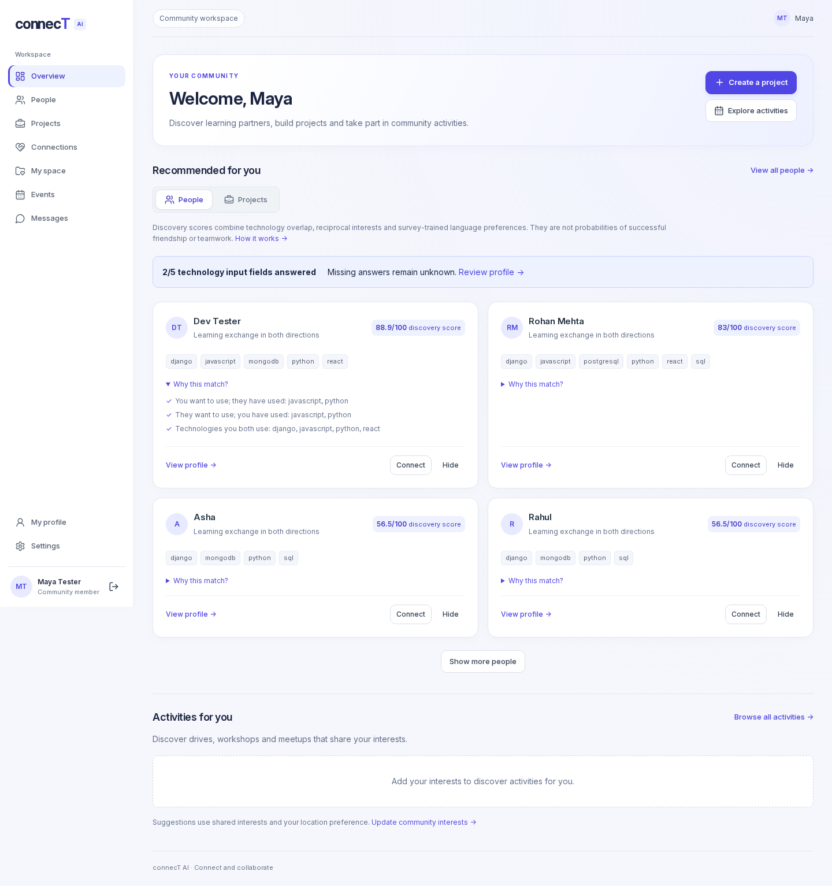

# connecT AI

An AI-powered university social and project collaboration platform for a B.Tech CSE major project.

[](https://github.com/majorproject4224-max/final-year-project/actions/workflows/ci.yml)

Students create profiles, connect, form project teams, chat and discover personalized suggestions. React is the interface; Django REST Framework and Channels provide the API and live chat; MongoDB stores application data. Offline scikit-learn models provide recommendations.

**The bundled data is synthetic.** Match percentages are model estimates learned from a documented development rubric, not validated probabilities of successful real collaboration.

## Start here

- **Office laptop / no local installations:** [Use GitHub Codespaces in your browser](docs/SETUP.md#browser-only-development).
- **Personal laptop:** [Windows setup and run instructions](docs/SETUP.md#personal-windows-laptop).
- **Free hosting:** [Vercel + Render + MongoDB Atlas deployment guide](docs/DEPLOYMENT.md). Deployment requires the owner's approval; no hosting accounts or resources are created by this repository.
- **Understand the code:** [Architecture](docs/ARCHITECTURE.md), [API reference](docs/API.md), [beginner learning guide](docs/LEARNING.md).
- **College report / viva:** [Project report](docs/PROJECT_REPORT.md), [ML methodology](docs/ML_METHODOLOGY.md), [measured results](docs/RESULTS.md), [demonstration script](docs/DEMO.md).

## Preview



[Mobile view](docs/screenshots/dashboard-mobile.png) · [Project team](docs/screenshots/project-team.png) · [Live chat](docs/screenshots/chat-desktop.png)

## Implemented workflows

| Area | Functionality |
|---|---|
| Accounts | Registration, login, rotating JWT refresh, logout, password changes and session revocation |
| Profiles | Skills/interests normalization, academic details, availability, contact privacy, optional PDF/DOCX résumé suggestions |
| Community | Student search, profile details, connection requests, acceptance/removal |
| Projects | Create/edit, apply/withdraw, owner decisions, invitations, capacity-safe team formation, progress and completed-project feedback |
| Discovery | Student → student, student → project and project → teammate recommendations with actual feature explanations |
| Events | Create, list upcoming events, attend/leave, organizer deletion |
| Messaging | One-to-one chat, private image/file attachments, previews/downloads, persistent history, read receipts, WebSocket delivery, reconnect and duplicate-safe sending |
| Personal space | My teams/projects, sent/received invitations and saved projects |

No external AI API subscription is needed. There is no automatic online retraining.

## Machine learning

- **K-Means:** TF-IDF features from normalized skills/interests; select k by silhouette over 2–10, retain inertia for analysis.
- **Random Forest:** separate student–student and student–project classifiers.
- **Evaluation:** entities are separated between training/test sets; supervised features are recomputed from raw profiles. Reports include majority and similarity baselines, confusion matrices and ranking metrics.
- **Artifacts:** the repository includes the offline trained bundle, Excel/CSV data and measured results. Inference loads the bundle once per process; request handlers do not train.

```text
backend/       Django API, Channels, permissions and domain services
frontend/      React pages, reusable components and API client
ml/            Shared preprocessing, offline training, saved model and metrics
dataset/       Reproducible generator + explicitly synthetic Excel/CSV datasets
docs/          Setup, architecture, API, methodology, results and report
scripts/       Development and deployment startup helpers
tests/         ML, résumé and browser journey tests
.devcontainer/ Browser-only development configuration
```

## Checks

GitHub Actions trains from the reproducible generator, checks Django, tests against a disposable MongoDB replica set and Redis, builds React, and runs a real Chromium browser journey. Test artifacts include screenshots, a browser trace, the trained model and measured metrics. See [testing instructions](docs/TESTING.md).

Do not run the database tests on an important database: they deliberately reset the database and refuse names that do not end in `_test`.

## Scope and limitations

This is an academic prototype, not a production university service. Free hosting can sleep and has usage limits. There is no email verification/recovery, moderation console, profile photo storage, group chat or presence indicator. Profiles use initials as avatars. Candidate retrieval is bounded for a small campus demo. Synthetic labels and related project scenarios limit what evaluation proves. Read [the limitations](docs/ML_METHODOLOGY.md#limitations) before presenting results.

The conceptual reference is [RohitGaira/connecT-University-Social-Platform](https://github.com/RohitGaira/connecT-University-Social-Platform). This implementation uses its own React/Django/MongoDB/ML architecture. Earlier Flask, SQLite and static-site experiments were removed from the current tree to leave one supported application; they remain in Git history at `8eaf15a`.
