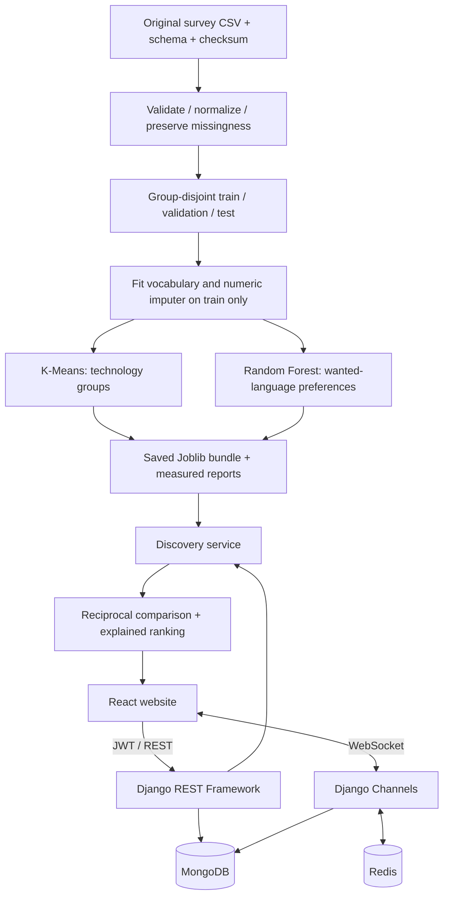
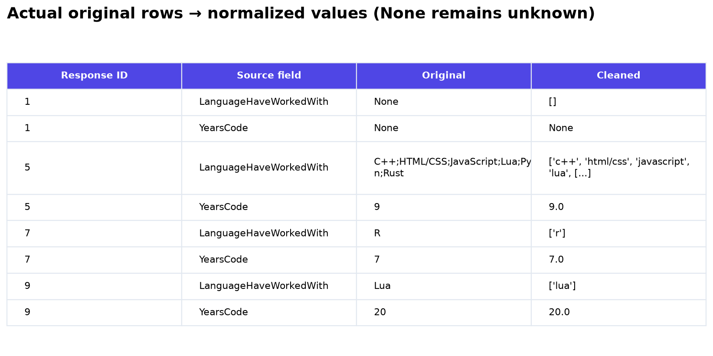
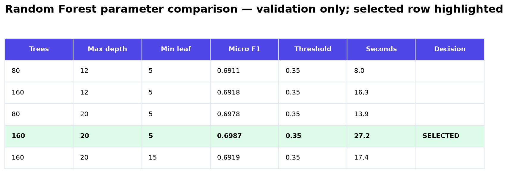
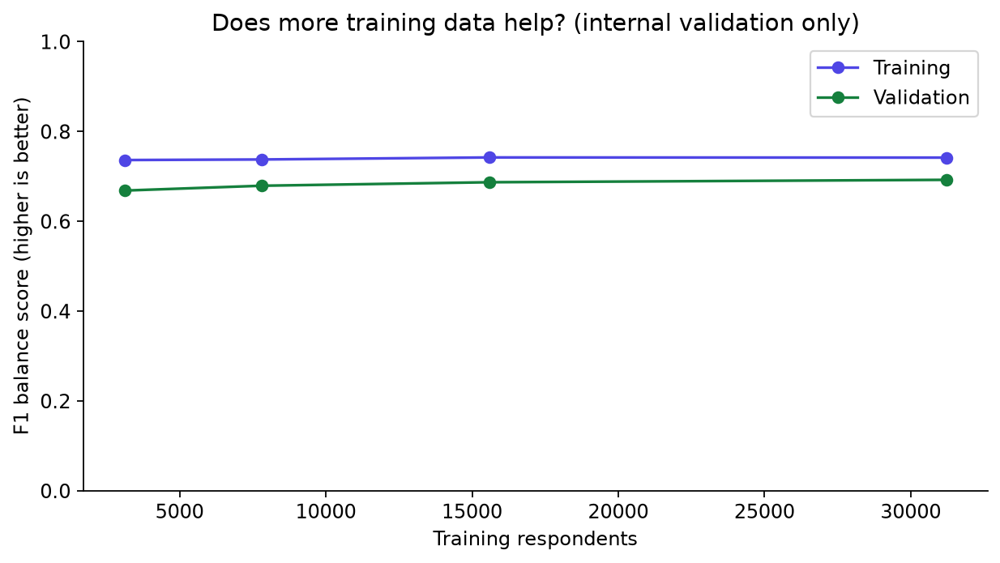
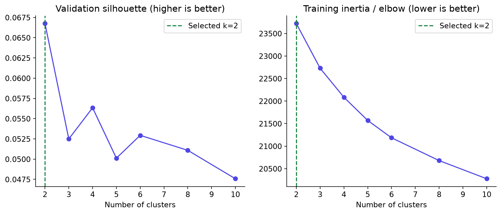
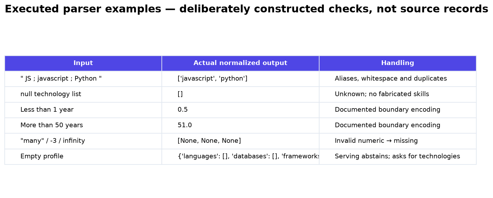
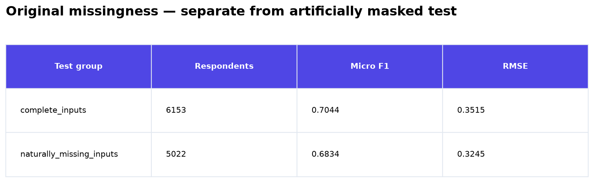
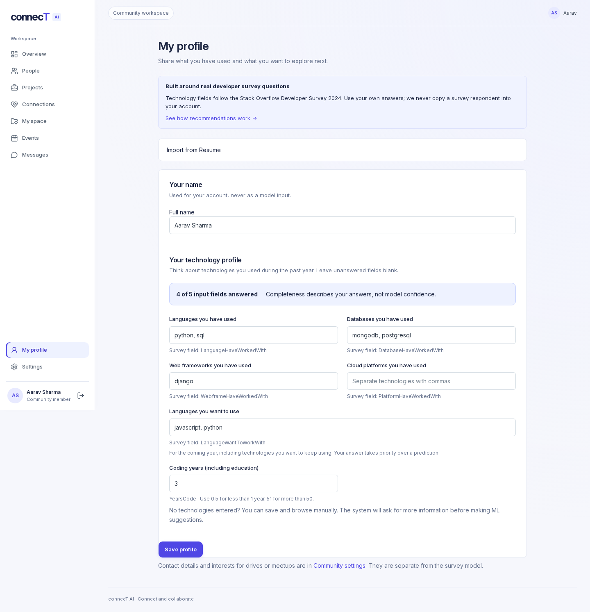
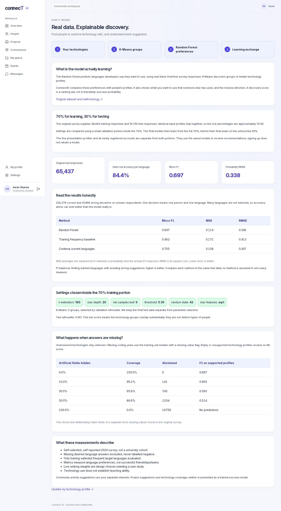
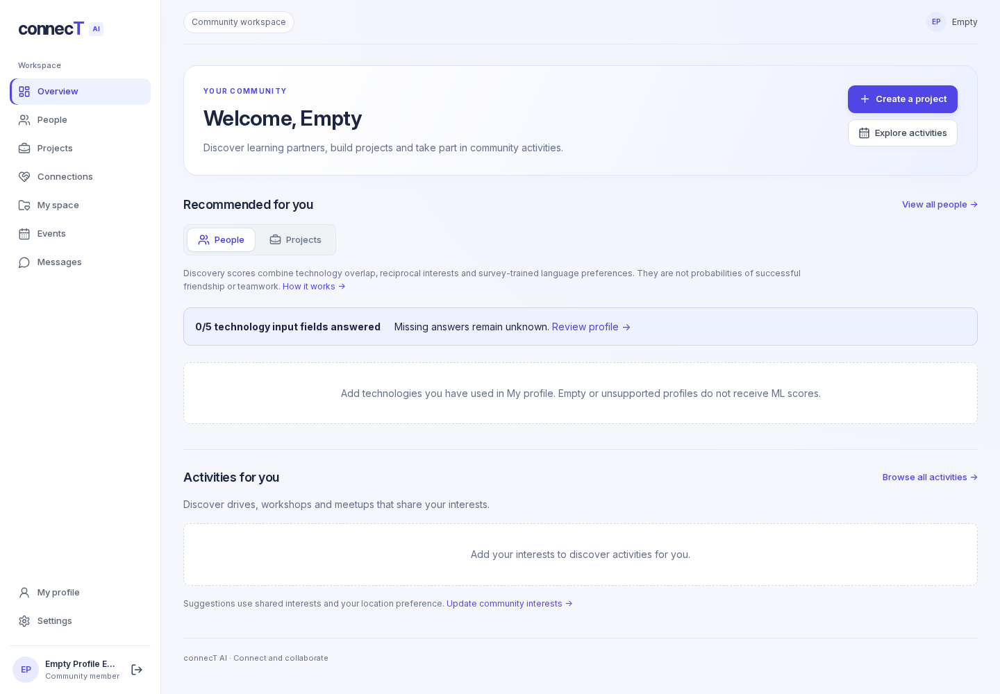

# ConnectAI

**AI/ML-Based Social Connection Recommendation Platform**

ConnectAI helps people discover technology learning partners, form project teams, message accepted connections, and organize community activities. The frontend is React; the backend is Django REST Framework and Channels; MongoDB stores application records.

The revised ML system uses **original Stack Overflow Developer Survey 2024 responses**, downloaded from the publisher and verified by SHA-256. It does **not** train on generated students, fictional accounts or hand-written compatibility labels.

## What problem does this version solve?

Finding someone with similar skills is useful, but it can miss a learning exchange: you want to use a technology another person has used, while you have used something they want to explore. ConnectAI adds **reciprocal learning discovery**, with explanations in both directions and visible handling of incomplete profiles.

This is a project-specific application of established recommendation ideas, not a claim to have invented a new ML algorithm. See [references and comparison](docs/REFERENCES.md).

**What the ML claim means:** Random Forest predicts respondents' stated future language preferences. K-Means groups technology profiles. A transparent ranking combines these with actual profile comparisons. The survey contains no friendship/team-success labels, so a discovery score is **not** a validated probability of successful collaboration.

## Original dataset and profile attributes

Source: [official Stack Overflow survey archive](https://github.com/StackExchange/Survey/tree/main/packages/archive/2024), [2024 methodology](https://survey.stackoverflow.co/2024/methodology). Data: **65,437 real responses, 114 columns**. The current experiment uses 55,752 eligible respondents. The respondents are anonymous survey records, not registered ConnectAI users.

| Website technology field | Original source column | Role |
|---|---|---|
| Languages used | LanguageHaveWorkedWith | Input |
| Databases used | DatabaseHaveWorkedWith | Input |
| Web frameworks used | WebframeHaveWorkedWith | Input |
| Cloud platforms used | PlatformHaveWorkedWith | Input |
| Coding years, including education | YearsCode | Input |
| Languages wanted for the coming year | LanguageWantToWorkWith | Real supervised target; explicit preference at serving time |

Name, authentication and contact details are operational account fields, never ML features. Interests for volunteering and meetups are separate community settings. Academic year, invented experience levels and generated domain categories no longer determine people recommendations.

Data/derived tables © Stack Exchange, Inc., under [ODbL 1.0](https://opendatacommons.org/licenses/odbl/1-0/); individual contents under DbCL 1.0. See [dataset provenance, checksum and preprocessing](dataset/README.md).

## Architecture



Training is offline; requests only load the saved model. Full [architecture and database design](docs/ARCHITECTURE.md).

## Real preprocessing evidence

The original file contains **5,692** missing language-use answers, **15,183** missing database answers, **20,276** missing framework answers, **23,071** missing platform answers, **5,568** missing coding-years answers and **9,685** missing target answers.

- Unanswered target fields are excluded from supervised training, not converted into negative labels.
- Semicolon lists are trimmed, case-normalized and deduplicated; documented aliases share a token.
- Missing numeric input uses the **training median of 11 years**, with a separate missing-value indicator.
- Invalid numeric values become missing during data ingestion; the API rejects invalid numbers.
- Identical normalized input profiles stay in one split. The encoder never learns vocabulary or statistics from test data.
- Artificial malformed-input and masking tests are labelled separately. The original source had **zero nonmissing invalid YearsCode values**; we do not invent corruption in the source.




## Measured training parameters and results

Full original-release experiment, seed 42, Python/scikit-learn in Codespaces. Splits: **33,415 training**, **11,162 validation**, **11,175 test** respondents, with no shared normalized input groups. The 16 target languages are selected by frequency/support **from training data only**.

Selected Random Forest parameters: **160 trees**, **maximum depth 20**, **minimum leaf size 5**, **threshold 0.35**, `max_features=sqrt`. Selection maximizes validation micro F1; the test set is not used to select parameters.




Random Forest has no neural-network epochs. The learning curve measures performance at increasing training-set sizes. The parameter table compares tree counts, depth, leaf size and runtime.

| Held-out method | Accuracy per language | Precision | Recall | Micro F1 | Probability MSE | RMSE |
|---|---:|---:|---:|---:|---:|---:|
| Random Forest | 84.26% | 0.6688 | 0.7262 | 0.6963 | 0.1154 | 0.3396 |
| Training-frequency baseline | 66.66% | 0.3868 | 0.5838 | 0.4653 | 0.1717 | 0.4143 |
| Continue currently used languages | 84.07% | 0.6529 | 0.7657 | **0.7048** | 0.1593 | 0.3992 |

**Interpretation:** the forest has lower probability error and slightly higher per-label accuracy, but the continuation baseline has better F1, recall and exact-profile accuracy. We do not claim universal superiority. Whole-profile exact accuracy for the forest is **17.61%**, distinct from per-language accuracy. There are many negative labels; accuracy alone is insufficient.

Of **178,800 person-language decisions**, **150,664 are correct** and **28,136 are wrong**: correct:wrong ≈ **5.35:1**. These are preference decisions, not successful/failed connections. MSE = mean((predicted probability − actual 0/1 answer)²); RMSE = √MSE.


K-Means selects **k=2** from 2, 3, 4, 5, 6, 8, 10 using validation silhouette (0.0668). Test silhouette is **0.0633**, indicating weak cluster separation. We do not assign invented expert/domain names to these groups. Explicit reciprocal matches may cross groups.



### Missing and irregular data behavior

| Deliberately hidden input fields | Supported-profile coverage | Micro F1 on supported profiles | Abstentions |
|---|---:|---:|---:|
| 0% | 100% | 0.6963 | 0 |
| 10% | 99.11% | 0.6651 | 100 |
| 30% | 95.71% | 0.5894 | 479 |
| 50% | 86.98% | 0.5066 | 1,455 |
| 100% | 0% | No prediction | 11,175 |

These are **artificial stress tests on held-out inputs**, not claims about additional source corruption. Naturally incomplete test profiles are evaluated separately. An empty or completely unsupported live technology profile receives guidance to add information, not a made-up score.




[Complete measured results and figures](docs/RESULTS.md) · [machine-readable metrics](ml/evaluation/survey2024/metrics.json) · [methodology and metric explanations](docs/ML_METHODOLOGY.md) · [teacher demonstration walkthrough](docs/TEACHER_DEMO.md)

## Website evidence

Screenshots below come from browser checks of the real application using **fictional UI test accounts**. Those accounts are never model-training or evaluation data.






## Platform workflows

| Area | Implemented behavior |
|---|---|
| Accounts | JWT registration/login, secure password hashing, refresh rotation, logout |
| People | Technology profiles, search, connection requests and reciprocal learning discovery |
| Projects | Create, apply, invite, team formation, status and feedback |
| Project recommendations | Explained technology coverage; no invented project-success classifier |
| Messaging | Django Channels, one-to-one WebSockets, read state, private images/files |
| Community | Individuals, clubs or NGOs can organize drives, workshops and meetups |
| Activity suggestions | Explicit interest/location matching, separate from technical ML |
| Evidence | Measured dataset audit, preprocessing examples, parameter search, baseline comparison, missing-field behavior |

## Run in GitHub Codespaces

No office-laptop installation is required. In the Codespace terminal:

```bash
bash scripts/start-data.sh
bash scripts/dev.sh
```

Open forwarded **port 5173**. The checked-in verified model is ready for inference. To reproduce the experiment in the cloud:

```bash
.venv/bin/python -m pip install -r ml/requirements-training.txt
.venv/bin/python -m ml.train --download
.venv/bin/python -m ml.export_data
```

The unchanged 159 MB CSV is stored under ignored `dataset/raw/`; checksums pin the exact original release. The export creates inspectable cleaned CSV and Excel files. The app never imports anonymous survey rows as registered people.

For an existing demonstration database, preview then apply the idempotent upgrade of marked fictional profiles:

```bash
.venv/bin/python backend/manage.py migrate_survey_profiles
.venv/bin/python backend/manage.py migrate_survey_profiles --apply
```

It backs up those profiles privately, preserves accounts/connections/messages, and leaves real users to complete their own new technology fields.

[Setup](docs/SETUP.md) · [testing](docs/TESTING.md) · [deployment planning](docs/DEPLOYMENT.md). Hosting/database choices still require the owner's review before deployment.

## Limits and next steps

This is a B.Tech academic prototype. The survey is self-selected, self-reported, from 2024, and not a representative university cohort. Its labels describe wanted technologies, not proficiency, teaching ability or interpersonal success. Ranking weights are transparent design choices; the complete social ranking still needs a consented user study. K-Means separation is weak, and a simple baseline beats the forest on some metrics.

Next: collect consented connection/collaboration outcomes, evaluate reciprocal recommendation usefulness, improve models without touching the held-out test set, and review free-hosting limits before deployment. There is no automatic online retraining.

The official project title remains **ConnectAI: AI/ML-Based Social Connection Recommendation Platform**.
