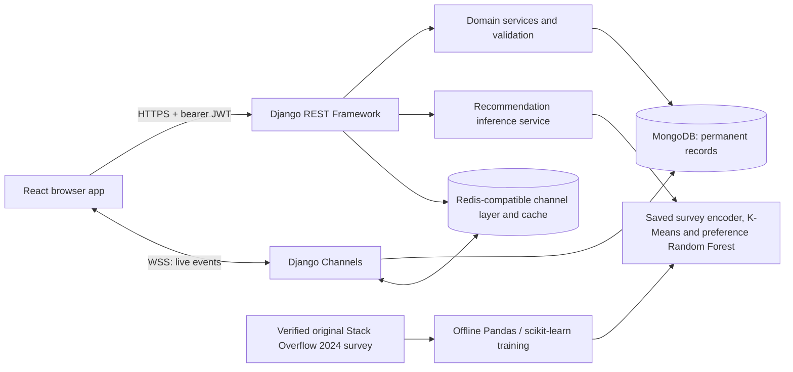
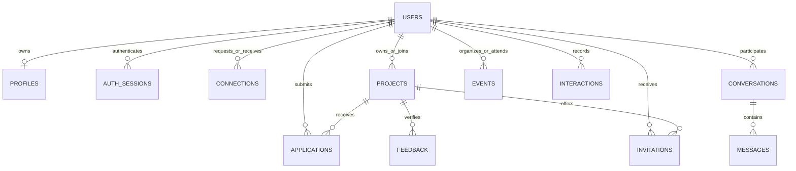

# Architecture and database decisions

## Application boundaries

The API and Channels share one Django/ASGI application. ML inference is an internal Python service. There is no second ML server and no training inside request handlers.

## Django and MongoDB

The pinned combination is Django 5.2, official `django-mongodb-backend` 5.2 and PyMongo 4, using Python 3.12. MongoDB requires the Django backend's major/minor version to match Django. The backend is maintained by MongoDB and uses PyMongo. [Compatibility matrix](https://www.mongodb.com/docs/drivers/compatibility/?driver-language=python&python-driver-framework=django), [official backend](https://www.mongodb.com/docs/languages/python/django-mongodb/v5.2/)

This project deliberately uses **explicit PyMongo document operations** for its domain collections. DRF serializers validate input; domain functions enforce permissions and state transitions. The Django MongoDB backend is configured for Django integration, but the platform does not pretend its document stores are ORM models. Custom MongoDB authentication uses Django password hashers and SimpleJWT. Django's SQL tables, SQLite and Djongo are not part of the running application.

This preserves the existing document architecture while making MongoDB transaction/index behavior explicit. The official backend has differences from SQL Django, including unsupported `select_for_update` and transaction restrictions. Our membership service uses a PyMongo session transaction and a conditional update instead of relying on relational row locking. [Feature compatibility](https://www.mongodb.com/docs/languages/python/django-mongodb/v5.2/limitations-upcoming/)

`manage.py setup_db` is the domain schema/index setup command. `migrate` does not create these collections. No Django admin is exposed.

## Modules

| Module | Responsibility |
|---|---|
| `accounts.py`, `authentication.py` | Registration, hashed credentials, JWT sessions, refresh rotation |
| `people.py` | Profiles, contact visibility, search and connections |
| `projects.py` | Projects, applications, invitations and member endpoints |
| `services/projects.py` | Shared ownership checks and atomic membership decisions |
| `community.py` | Events, feedback and saved/ignored targets |
| `messaging.py` | History, idempotent send, read receipts, WebSocket tickets and consumer |
| `attachments.py` | Bounded multipart uploads, file validation, image sanitization and metadata |
| `recommendations.py` | Three authenticated recommendation endpoints |
| `services/recommendations.py` | Model loading, candidate generation and inference |
| `ml/survey.py`, `ml/discovery.py` | Shared survey encoder, people profile comparisons and explanations |
| `ml/train.py` | Offline training, evaluation and persistence |

One Django domain app is split into meaningful modules rather than many near-empty apps. Views do input/output handling; shared membership and ML logic lives in services. Small serializers remain explicit.

## Document relationships

| Collection | Main fields / invariant |
|---|---|
| users | `_id, name, email, password_hash, is_active`; unique normalized email |
| profiles | unique `user_id`; languages, databases, frameworks, platforms, coding years, wanted languages; separate community/contact settings |
| connections | unique scalar `pair_key`, requester/recipient IDs, Pending/Accepted |
| projects | owner ID, member-ID array, requirements, status, capacity and timestamps |
| applications | unique project/user pair, decision and timestamps |
| invitations | unique project/recipient pair, sender and decision |
| conversations | unique sorted pair key; participant array is indexed **without** uniqueness |
| messages | conversation/sender/content/timestamp/read-by IDs, small binary attachments and metadata; unique conversation/sender/client UUID prevents retry duplicates |
| storage_usage | Shared attachment byte counter; reservation and message insert are transactional |
| events | organizer, start time, location, attendee-ID array |
| feedback | unique project/reviewer/recipient tuple, rating/comment, verified-completed-project source |
| interactions | unique user/type/target/action tuple for view/save/ignore |
| auth_sessions | random session ID, current refresh JTI, user and expiry |
| websocket_tickets | one-use ticket hash, user/session/conversation and 60-second expiry |

Skills/interests are small normalized string arrays on profiles and projects; separate lookup collections would add needless joins. Teams are the members of a project, so a separate duplicated team-membership collection is unnecessary.

## Concurrency and state

- Accepting an application or invitation updates both the request and project in a transaction. A conditional update requires an open project, available capacity and absent membership.
- Two requests for the last slot cannot both succeed. A conflict is returned as HTTP 409.
- Project closing and new applications touch the same project document, so concurrent changes are retried consistently.
- Events use set updates rather than incrementing a separate attendance counter.
- A message's client UUID makes repeated sends idempotent.
- Transactions require a MongoDB replica set, provided by Atlas or the development Docker setup.

Project states: Open → In Progress → Completed; In Progress may reopen recruitment; Open/In Progress may be Cancelled. Completed/Cancelled projects preserve their membership and details for history. Feedback requires a shared completed project.

## Authentication and chat

Access tokens last 15 minutes. Refresh tokens last 7 days and rotate; the previous refresh JTI is rejected after use. MongoDB session records let logout/password changes revoke access immediately. Browser tokens use sessionStorage, so closing the browser tab ends the local session. JavaScript-accessible tokens still require careful XSS prevention; React escapes displayed strings and no arbitrary HTML is rendered.

The browser obtains a single-use WebSocket ticket through an authenticated API call. The stored hash expires after 60 seconds and is bound to user/session/conversation. Channels checks origin, ticket, active session and accepted connection. Authorization is rechecked for messages and broadcasts. Access/refresh tokens are not placed in WebSocket URLs.

The UI sends durable messages through the authenticated REST endpoint and receives live message/read events through **Django Channels WebSockets**. The consumer also supports validated WebSocket sends. Redis carries short-lived group events, while MongoDB keeps history. Reconnect requests new tickets and catches up on missed history. The “Live” indicator describes the connection, not the other student's presence.

Chat attachments are limited to 3 files / 10 MiB per message (5 MiB each), stored in the same MongoDB document as the message for this small presentation. Binary fields are excluded from all history queries; only metadata travels over Channels. Downloads recheck authentication, conversation membership and the accepted connection. The total default attachment budget is 100 MiB, reserved transactionally to avoid concurrent over-allocation. No cloud storage account or persistent web-server disk is needed. This is deliberately a bounded prototype: there is no virus scanning, deletion/retention UI or scalable object-storage integration. Images are decoded/re-encoded to strip metadata; document/archive files are never rendered or extracted by the server.

## Deployment boundaries

React is a static Vite build on Vercel. Uvicorn runs Django/Channels on Render. MongoDB Atlas is the primary persistent database. Render Key Value provides Redis-compatible transient messaging/cache. Only frontend API/WS URLs are exposed through Vite environment variables.

The API uses explicit CORS and WebSocket origins, server-side ownership checks, validation, hashed passwords and rate limits. Resumés are parsed in memory; there is no local upload directory or persistent disk requirement. See [deployment instructions](DEPLOYMENT.md).
