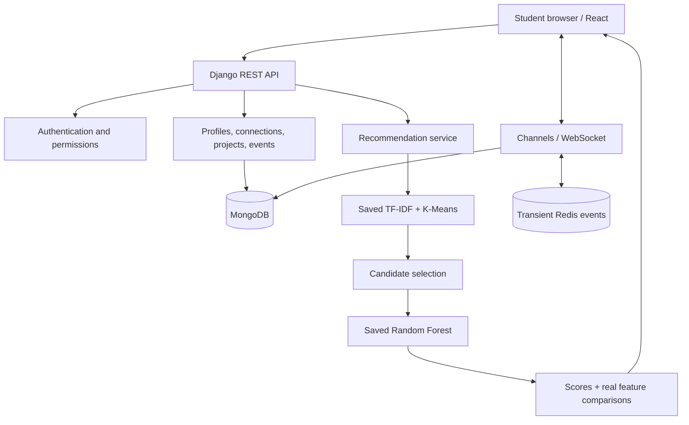

# connecT AI — AI-Powered University Social and Project Collaboration Platform

B.Tech Computer Science and Engineering major-project technical report.

## 1. Introduction

Students often learn about potential collaborators through existing friends, class groups or chance encounters. Skills, interests, project requirements and availability are spread across messages and profiles. This project brings those details together and uses machine learning to support discovery.

The objective is to help students find people, create teams and communicate while providing a reproducible, explainable recommendation pipeline. A match is a starting point for discussion rather than a promise of successful teamwork.

## 2. Existing system and conceptual reference

The reference [connecT university social platform](https://github.com/RohitGaira/connecT-University-Social-Platform) demonstrates profiles, friendship, projects, teams, events and messaging. The initial repository also contained partial React/Django code alongside earlier Flask/SQLite/static experiments.

The redesign preserves useful user journeys but consolidates the application into React, Django REST Framework, MongoDB and Channels. It replaces rule-only matching assumptions with separately trained models and documented labels. It addresses ownership checks, contact privacy, duplicate conversations, team capacity, session revocation and split frontend/backend configuration.

## 3. Proposed system

Students create structured profiles, discover peers, send connection requests, create or apply to projects, invite teammates, attend events and chat. The dashboard integrates recommendations with feature-comparison reasons. Project owners see candidates evaluated against the project's required skills and hours.

The main contribution is a hybrid recommendation pipeline with a reproducible development dataset, shared preprocessing, K-Means candidate discovery, two Random Forest ranking models, entity-disjoint evaluation and explicit disclosure of synthetic-data limitations.

## 4. Technology stack

React/JavaScript with React Router, Axios and responsive CSS; Python/Django 5.2 with DRF, SimpleJWT and Django Channels; MongoDB with the official Django backend configuration and explicit PyMongo document services; Redis-compatible Channels delivery; Pandas, NumPy, scikit-learn, Joblib and openpyxl.

The database decision and compatibility sources are documented in [ARCHITECTURE.md](ARCHITECTURE.md). The implementation does not require a paid generative-AI service.

## 5. System architecture

The ML training process runs offline and writes versioned artifacts. API requests perform inference only. Messaging is isolated from recommendation logic.

## 6. Database design

Users and profiles are separated to isolate credentials. Profiles hold small normalized skill/interest arrays. A project embeds member IDs; requests and invitations remain separate records. Transactions keep decisions and membership consistent. Conversations have a scalar unique participant-pair key; messages are separate, cursor-paginated records. Events use attendee sets; feedback requires a shared completed project. See the relationship diagram and collection/index table in [ARCHITECTURE.md](ARCHITECTURE.md).

## 7. ML methodology

The four development tables contain fictional profiles, project scenarios and labeled pairs. Labels are reproducible rubric judgments with explicit provenance. The supervised model is trained on those labels, so its current purpose is to validate the pipeline rather than establish real human compatibility.

Normalization handles case, whitespace, aliases, duplicates and missing values. Derived features include Jaccard similarities, directional skill coverage, experience and availability compatibility. K-Means selects k by silhouette; Random Forest predicts pair-level compatibility. Classifier evaluation holds out student identities, and student–project evaluation holds out project identities too.

The complete formulas, split design, ranking scope, limitations and real-data replacement process are in [ML_METHODOLOGY.md](ML_METHODOLOGY.md).

## 8. Results

Actual cloud-generated results are reproduced in [RESULTS.md](RESULTS.md) from `ml/evaluation/metrics.json`. Selected k is 7, with silhouette approximately 0.297. The student classifier has F1 approximately 0.946 on 390 held-out pairs. The student–project classifier reproduces the synthetic test rubric perfectly on 405 held-out pairs; this is a limitation of the synthetic evaluation setting, not proof of perfect real-world recommendations.

Functional verification uses a real disposable MongoDB replica set, Redis, backend/ML checks and browser journeys. The corresponding [GitHub workflow](https://github.com/majorproject4224-max/final-year-project/actions/workflows/ci.yml) and saved artifacts make failures and successful runs inspectable.

## 9. Security and validation

The application hashes passwords, rotates refresh tokens, revokes sessions, restricts records by ownership/membership, validates structured inputs and enforces unique indexes. Chat requires an accepted connection, an allowed origin and a short-lived single-use ticket. Secrets belong in private environment settings. Résumé suggestions require user review before saving. Contact numbers are shared only with consent and accepted connections.

The project is an academic prototype. These controls do not substitute for a full security review before institutional production use.

## 10. Limitations

Synthetic labels, scenario reuse, narrow skill vocabulary and small held-out positive counts limit generalization. The evaluation is a single fixed entity split; classifier metrics do not cover full-catalog candidate recall. Scores are uncalibrated. Free hosting can sleep or suspend service at limits. The current application does not include email verification/recovery, moderation, uploaded avatars, group chat or online-presence tracking.

No real student data or observational results should be claimed in the final presentation.

## 11. Future work

Collect consented real collaboration outcomes; evaluate temporal/entity generalization and fairness; compare collaborative filtering and learned ranking; add calibrated probability estimates and better candidate retrieval; consider NLP skill extraction after building a reviewed vocabulary. Product improvements include email verification/recovery, administrator moderation, notification preferences, group conversations and storage-backed avatars.

## 12. Reproduction and demonstration

Follow [SETUP.md](SETUP.md) for personal-laptop or browser-only development, [TESTING.md](TESTING.md) for verification, [DEPLOYMENT.md](DEPLOYMENT.md) for the proposed free hosting setup, and [DEMO.md](DEMO.md) for a guided presentation. Deployment is a separate owner-approved activity.
