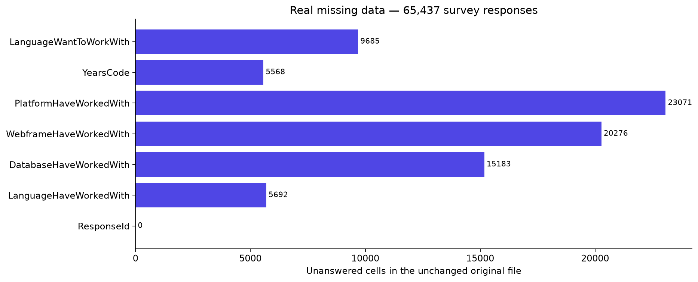
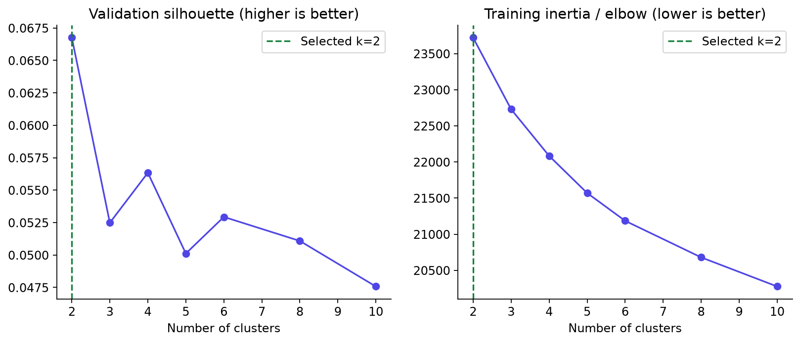
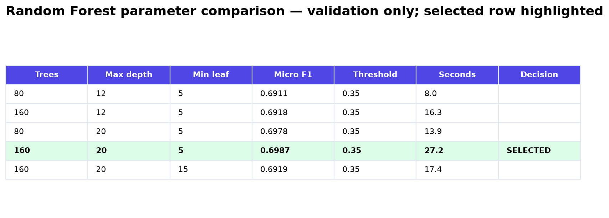
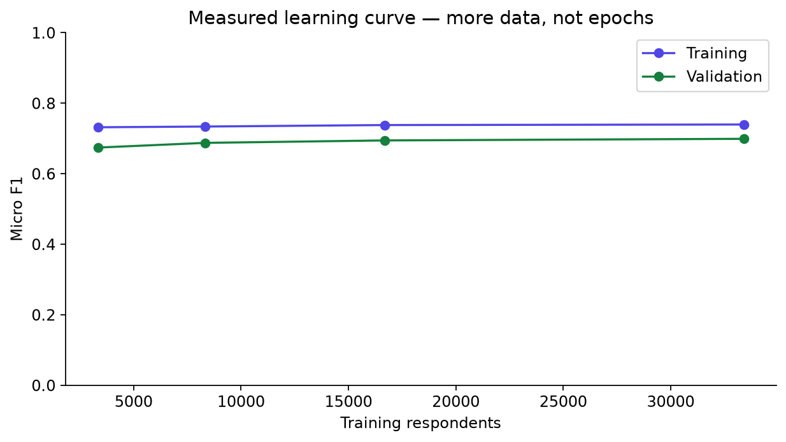
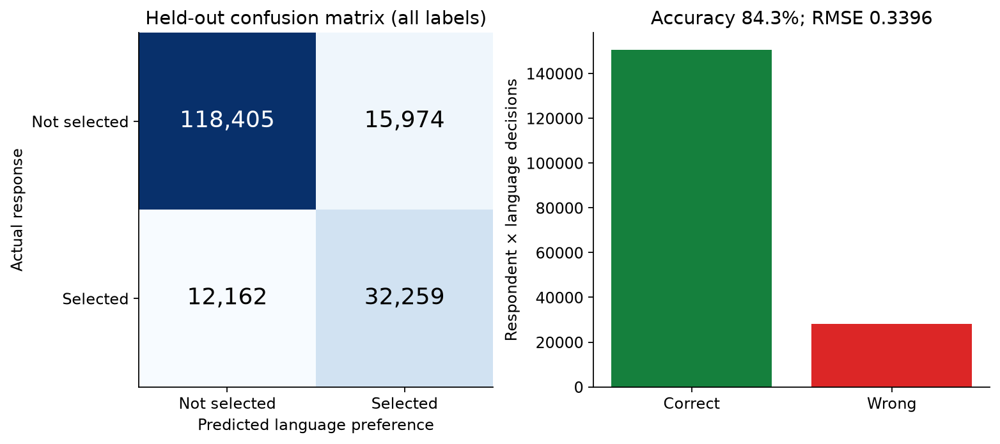
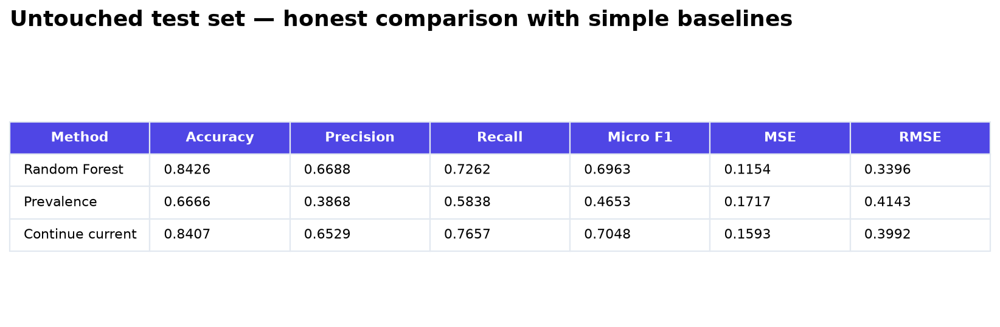
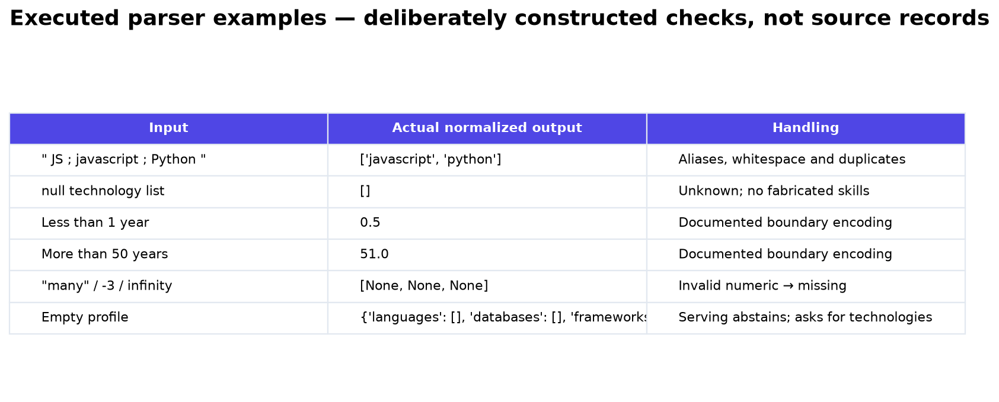
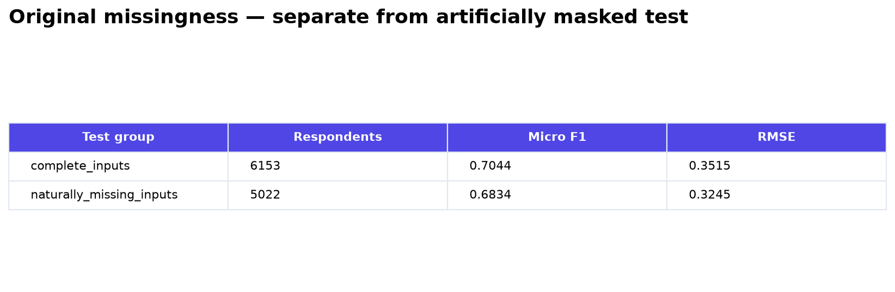

# Measured real-data results

Generated by the experiment at 2026-11-19T14:42:07.576196+00:00. Run: **full_verified_release**.

Task: predict stated future language preferences from current technologies and coding years. These are not friendship-success results.

Original rows: **65,437**. Eligible: **55,752**. Training median coding years: **11**.

| Split | Respondents | Unique input groups |
|---|---:|---:|
| train | 33,415 | 32,788 |
| validation | 11,162 | 10,929 |
| test | 11,175 | 10,930 |

Group overlap: **0**. Exact normalized input profiles stay in one partition.

| Model | Accuracy per label | Precision | Recall | Micro F1 | MSE | RMSE |
|---|---:|---:|---:|---:|---:|---:|
| Random Forest | 0.8426 | 0.6688 | 0.7262 | 0.6963 | 0.1154 | 0.3396 |
| Prevalence | 0.6666 | 0.3868 | 0.5838 | 0.4653 | 0.1717 | 0.4143 |
| Continue current | 0.8407 | 0.6529 | 0.7657 | 0.7048 | 0.1593 | 0.3992 |

Correct: **150,664**; wrong: **28,136**. One decision means one held-out respondent and one target language. Exact whole-profile accuracy: **0.1761**.

MSE averages (predicted probability − actual 0/1 response)². RMSE is its square root. Lower is better. Accuracy includes many negative labels; always read F1, recall and the baselines too.

Selected parameters: `{"max_depth": 20, "max_features": "sqrt", "min_samples_leaf": 5, "n_estimators": 160, "random_state": 42, "threshold": 0.35}`.

K-Means selected **k=2** by validation silhouette. Held-out silhouette: **0.06328511925830609**.

## Limits

- Self-selected, self-reported 2024 survey; not a university cohort.
- Missing desired-language answers excluded, never labelled negative.
- Only training-selected frequent target languages evaluated.
- Metrics measure language preferences, not successful friendships/teams.
- Live ranking weights are design choices needing a user study.
- Technology use does not establish teaching ability.

Source: [Stack Overflow Developer Survey 2024](https://survey.stackoverflow.co/2024/methodology), © Stack Exchange, Inc. Data/derived tables: [ODbL 1.0](https://opendatacommons.org/licenses/odbl/1-0/), contents DbCL 1.0.