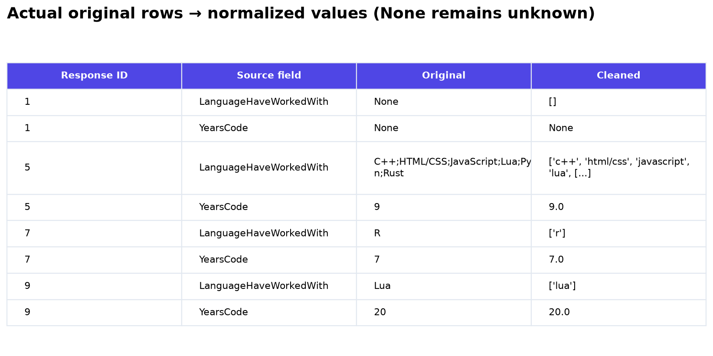
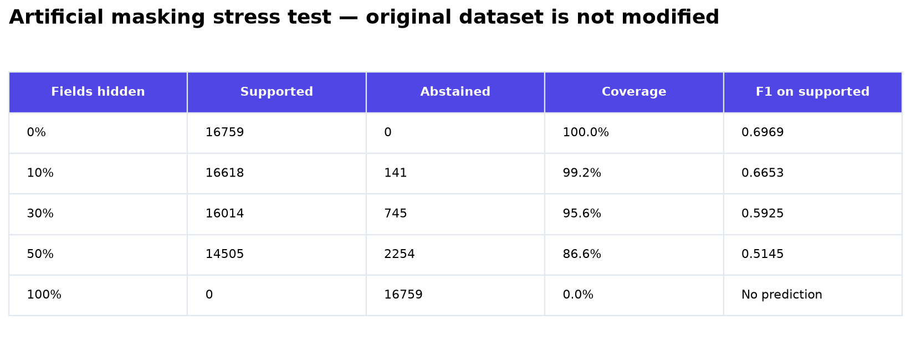

# Measured real-data results

Generated by the experiment at 2026-11-19T17:28:45.746228+00:00. Run: **full_verified_release**.

Task: predict stated future language preferences from current technologies and coding years. These are not friendship-success results.

Original rows: **65,437**. Eligible: **55,752**. Training median coding years: **11**.

| Split | Respondents | Unique input groups |
|---|---:|---:|
| train | 38,993 | 38,252 |
| test | 16,759 | 16,395 |

## 70:30 training and testing, in simple terms

Training is the study material; testing is the final exam. Registered website profiles (including the five presentation accounts) are outside both datasets.

Inside the training portion, 31,228 rows fit candidate models and 7,765 rows compare settings. After selecting settings, the encoder, K-Means and Random Forest are fitted again on all 38,993 training rows. The 16,759 test rows are not used to choose settings.

The 70:30 ratio applies to groups of identical normalized inputs. Row percentages are very close to 70:30 because group sizes differ.

Group overlap: **0**. Exact normalized input profiles stay in one partition.

| Model | Accuracy per label | Precision | Recall | Micro F1 | MSE | RMSE |
|---|---:|---:|---:|---:|---:|---:|
| Random Forest | 0.8439 | 0.6664 | 0.7304 | 0.6969 | 0.1141 | 0.3377 |
| Prevalence | 0.6662 | 0.3826 | 0.5837 | 0.4622 | 0.1706 | 0.4131 |
| Continue current | 0.8420 | 0.6514 | 0.7685 | 0.7051 | 0.1580 | 0.3974 |

Correct: **226,278**; wrong: **41,866**. One decision means one held-out respondent and one target language. Exact whole-profile accuracy: **0.1832**.

MSE averages (predicted probability − actual 0/1 response)². RMSE is its square root. Lower is better. Accuracy includes many negative labels; always read F1, recall and the baselines too.

Selected parameters: `{"max_depth": 20, "max_features": "sqrt", "min_samples_leaf": 5, "n_estimators": 160, "random_state": 42, "threshold": 0.35}`.

K-Means selected **k=2** by validation silhouette. Held-out silhouette: **0.06110261408453021**.

## How to read the figures

- **Data separation:** survey training/testing and live website users are different data flows.
- **Missing values:** longer bars mean more unanswered cells in the original survey.
- **Before/after:** the same response ID shows what cleaning changed.
- **Cluster selection:** higher silhouette means more separated groups; near zero means overlap. Inertia shows within-group spread.
- **Settings:** the green row has the best internal-validation F1 among the tried settings. More trees/depth do not automatically mean a better result.
- **Learning curve:** left-to-right means more fitting rows. Green shows performance on internal validation; blue shows the rows used for fitting. This is not training by epochs.
- **Correct/wrong:** green bar counts correct language decisions; red counts mistakes. The matrix separates missed interests from wrongly suggested interests.
- **Baselines:** compare against simple alternatives on the same test respondents. Higher F1 and lower MSE/RMSE are better.
- **Hidden fields:** deliberately remove answers to check reliability. Abstained means the system requested more input instead of guessing.
- **Parser checks:** intentionally constructed irregular inputs; they are not claimed to be original dataset rows.
- **Natural missingness:** evaluates real incomplete source records, separately from deliberately hidden inputs.

## What these results measure

- Self-selected, self-reported 2024 survey; not a university cohort.
- Missing desired-language answers excluded, never labelled negative.
- Only training-selected frequent target languages evaluated.
- Metrics measure language preferences, not successful friendships/teams.
- Live ranking weights are design choices needing a user study.
- Technology use does not establish teaching ability.

Source: [Stack Overflow Developer Survey 2024](https://survey.stackoverflow.co/2024/methodology), © Stack Exchange, Inc. Data/derived tables: [ODbL 1.0](https://opendatacommons.org/licenses/odbl/1-0/), contents DbCL 1.0.